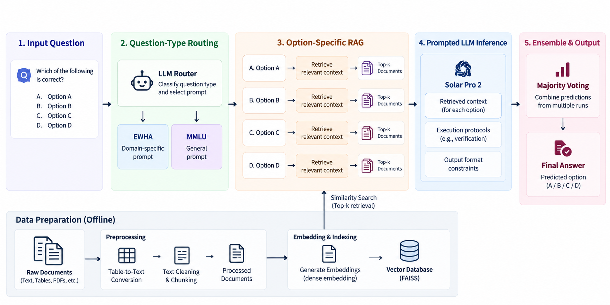

## Option-Specific RAG for LLM Question Answering 
### 📖 Introduction

This project aims to improve the multiple-choice question answering performance of **Solar Pro 2** through option-specific Retrieval-Augmented Generation (RAG), question-type-aware prompt engineering, and ensemble-based answer selection.

### 📌 Key Features

1. **Question-Type-Aware Routing:** Used an LLM-based router to select tailored prompts for school policy and MMLU questions.
2. **Table-to-Text Conversion:** Converted tabular content into structured text to make retrieved information more accessible to the LLM.
3. **Option-Specific RAG:** Retrieved supporting context separately for each answer option, addressing the limitations of retrieving context only once for the entire question and all options.
4. **Error-Driven Prompt Engineering:** Iteratively refined prompts based on observed model errors, incorporating explicit verification steps, reasoning instructions, and output-format constraints.
5. **Majority-Voting Ensemble:** Aggregated predictions through majority voting to improve the consistency and robustness of final answers.

### 🧩 System Architecture



### ✨ Results

| Dataset | Correct / Total | Accuracy |
|---|---:|---:|
| School Policy | 25 / 25 | **100%** |
| MMLU | 19 / 25 | **76%** |
| **Overall** | **44 / 50** | **88%** |


### 🛠️ Setting

1. Clone this repository to your local.
   ```
   git clone https://github.com/juminsuh/Team5_NLP_Upstage.git
   ```
2. Please download ```faiss_vectorstore``` folder from [google drive](https://drive.google.com/drive/u/0/folders/1XI0D3OtXREUscMaqnuW2oKZk7bM7KV6U). (😂 It might take a few minutes due to it's large size (i.e., 1.1GB))
3. Unzip ```faiss_vectorstore```.
4. Make sure to set the ```faiss_vectorstore``` directory such as ➡️ ```./Team5_NLP_Upstage/faiss_vectorstore```
5. Make `.env` file and write ```UPSTAGE_API_KEY="your_upstage_api_key"``` to ```.env``` file. (The directory of your `.env` file is ```./Team5_NLP_Upstage/.env```)

### 🔗 Requirements

1. Create your virual enviroment and activate it
```
conda create -n team5 python=3.10 -y # create
conda activate team5 # activate
```
2. Install
```
pip install -r requirements.txt
```

### 🔥 Implement 
```
python run.py --data_path ./datasets/testset.csv
```
➡️ If you want to evaluate other testset, then just change the value of `--data_path`.
```
python run.py --data_path <your_testsets_directory>
```
✅ You can check total score by running the code below (You should modify the directory of score.py appropriately before you run the code):
```
python score.py
```

### 😊 My Contribution

**Minsuh Joo: RAG Pipeline & Prompt Engineering**

- **Data Processing:** Developed the data processing pipeline for school policy-specific question-answering system. Identified tables embedded in raw text as a bottleneck for QA performance and restructured them into coherent, retrieval-friendly text representations to improve the usability of the source documents.
- **RAG Strategy**: Designed an option-specific RAG approach that retrieves supporting documents for each answer choice independently, allowing the model to assess whether each option is true or false based on retrieved evidence. Proposed a majority-voting ensemble that solves each question multiple times and aggregates the predictions, achieving up to 88% validation accuracy. Additionally, incorporated both relevance and diversity into document retrieval to reduce redundancy and provide broader supporting evidence.
- **Prompt Engineering:** Analyzed error patterns in validation questions and translated recurring failure cases into generalizable instructions, such as avoiding unsupported assumptions and selecting the closest available option when no answer appears fully correct. Structured the reasoning workflow into explicit stages—question comprehension, step-by-step reasoning, and answer verification—rather than relying on a single-step instruction.
- **Code Integration & Refactoring:** Integrated independently developed components from team members and refactored the codebase into a unified, end-to-end QA pipeline, enabling retrieval, answer generation, and verification to run within a single workflow. 
- **Project Documentation:** Organized the GitHub repository and prepared project documentation.
- **Presentation:** Created presentation slides and delivered the final project presentation.

### 📚 Source

We utilized textbook and QA datasets from hugging face. 
* [law_001](https://huggingface.co/datasets/ymoslem/Law-StackExchange) [law_002](https://huggingface.co/datasets/reglab/barexam_qa)
* [philosophy_001](https://huggingface.co/datasets/burgerbee/philosophy_textbook) [philosophy_002](https://huggingface.co/datasets/burgerbee/religion_textbook) [philosophy_003](https://huggingface.co/datasets/sayhan/strix-philosophy-qa)
* [business_001](https://huggingface.co/datasets/theoldmandthesea/17k_business_book) [business_002](https://huggingface.co/datasets/warrencain/Business_Knowledge_Dataset_Llama_3.1_Short_Token_Pairs)
* [history_001](https://huggingface.co/datasets/nielsprovos/world-history-1500-qa) [history_002](https://huggingface.co/datasets/burgerbee/history_textbook)
* [psychology_001](https://huggingface.co/datasets/BoltMonkey/psychology-question-answer) [psychology_002](https://huggingface.co/datasets/burgerbee/psychology_textbook/viewer/default/train?row=99&views%5B%5D=train)
